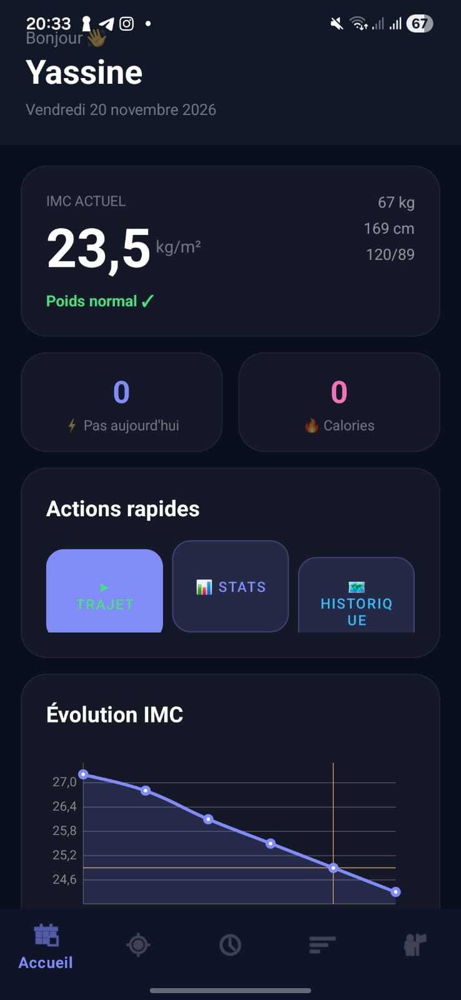
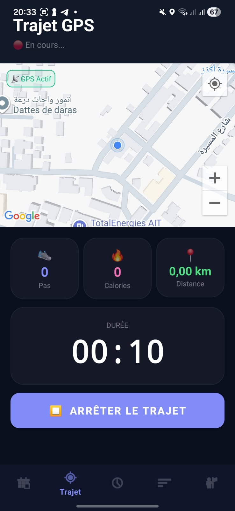
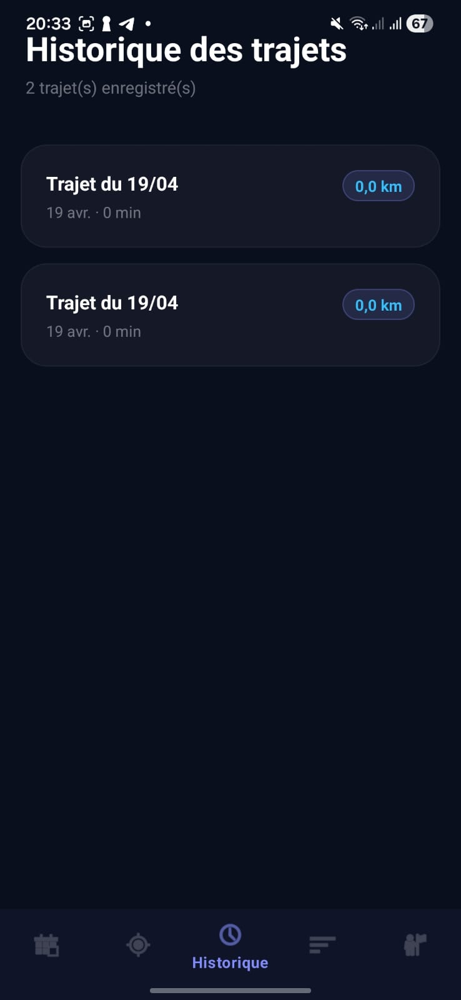
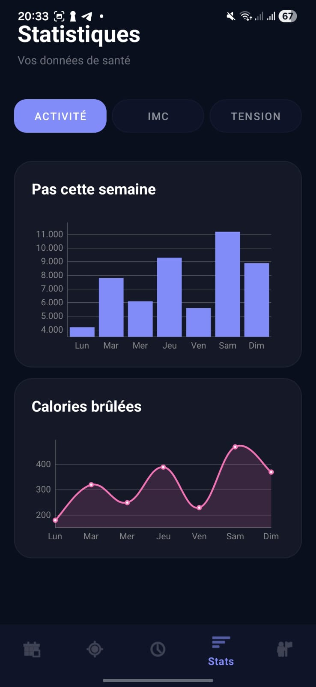
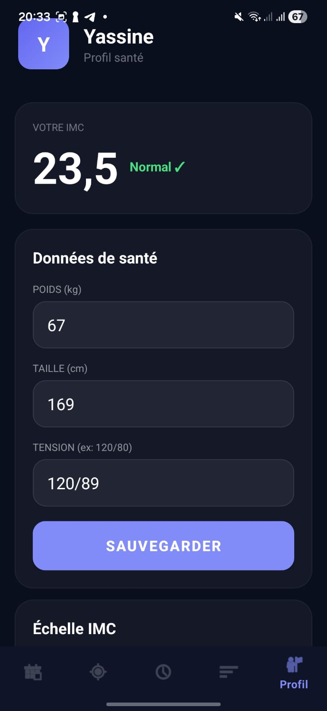

# HealthTrack2 📱

**HealthTrack2** is an Android mobile application developed using Kotlin. It helps users track their physical activity, monitor routes using GPS, and visualize activity information.

## ✨ Features

- **Login:** User login interface.
- **GPS Tracking:** Track routes using the device's GPS location.
- **Google Maps:** Display geographical locations and routes.
- **Activity History:** View previously recorded routes.
- **Statistics:** Visualize activity data using charts.
- **User Profile:** Access the user's profile.

## 🛠️ Technologies Used

- Kotlin
- Android Studio
- Android SDK
- XML Layouts
- ViewBinding
- Room Database
- Google Maps SDK
- Google Play Services Location
- Android Navigation Component
- MPAndroidChart
- Kotlin Coroutines

## 📂 Project Structure

```text
HealthTrack2/
├── app/
│   ├── src/main/
│   │   ├── java/com/example/healthtrack/
│   │   │   ├── data/
│   │   │   ├── ui/
│   │   │   ├── LoginActivity.kt
│   │   │   └── MainActivity.kt
│   │   ├── res/
│   │   └── AndroidManifest.xml
│   └── build.gradle.kts
├── gradle/
├── build.gradle.kts
└── settings.gradle.kts
```

## ⚙️ Installation

1. Clone the repository:

```bash
git clone https://github.com/AfafAK/HealthTrack2.git
```

2. Open the project using Android Studio.

3. Add your Google Maps API key to the local `local.properties` file:

```properties
MAPS_API_KEY=YOUR_GOOGLE_MAPS_API_KEY
```

4. Sync the project with Gradle.

5. Run the application on an Android device or emulator.

## 🔐 Security

The Google Maps API key is configured locally and should never be committed to the public repository.
## 📸 Application Screenshots

### 🏠 Home


### 📍 GPS Tracking


### 📋 Activity History


### 📊 Statistics


### 👤 User Profile


## 👩‍💻 Author

**Afaf Ait Khouya**

GitHub: [AfafAK](https://github.com/AfafAK)

---

*Android Mobile Application Development Project*
